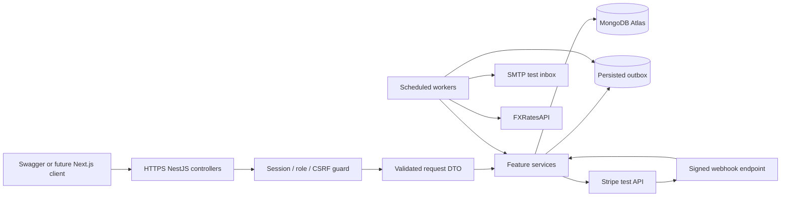
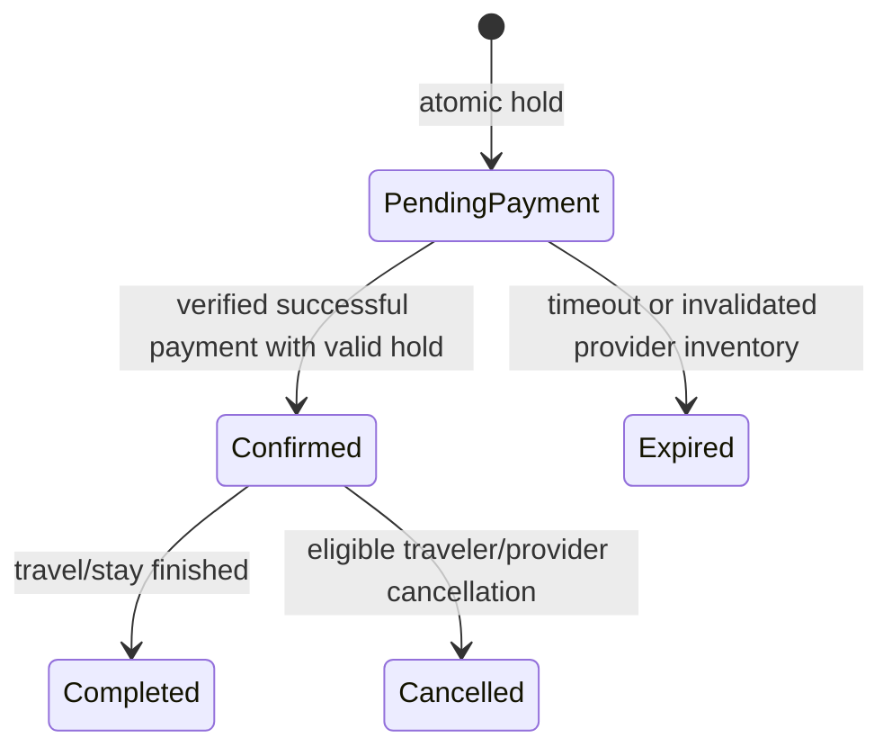

# Reverse engineering and implementation handover

This document explains the implementation delivered in this repository, how to reconstruct its behavior, and where its verification stops. It does not assert that an independent human reviewed the code or that unconfigured external accounts were exercised.

## 1. Reconstruct the project from its inputs

The original workspace contained only the project PDF and requirements workbook in `Objectives/`. The PDF defines NestJS/MongoDB Atlas for Milestone 1, Next.js for Milestone 2, the endpoint expectations, Swagger evaluation, Git workflow, and AI disclosure. The workbook supplies 104 mandatory requirements and 11 bonuses.

`scripts/import_sources.py` reads the supplied workbook without modifying it and preserves requirement text, IDs, actors, complexity, and dependencies in `docs/requirements/requirements.json`. It downloads the linked official reference workbook and saves its four eight-record tables in `backend/data/reference.json`. Official identifiers remain strings such as `CAI`, `cairo`, `EG`, and `att-1`.

`scripts/build_traceability.py` combines those source requirements, implementation mappings, and the exported OpenAPI operations into Markdown, CSV, and JSON registers. The original wording stays available in the JSON. Generated traceability describes implementation coverage; it does not replace acceptance testing.

## 2. Repository and runtime map

| Location | Responsibility |
| --- | --- |
| `backend/src/main.ts` | Load local environment, require HTTPS credentials, start loopback server |
| `backend/src/bootstrap.ts` | Validation, errors, cookie parsing, security headers, CORS, request throttling, Swagger, schema/index initialization |
| `backend/src/app.module.ts` | Assemble feature modules and the global authorization guard |
| `backend/src/database.ts` | Explicit collection schemas, indexes, database lookup and transaction helpers |
| `backend/src/dto.ts` | Accepted HTTP inputs and Swagger request schemas |
| `backend/src/common.ts` | Dates, money, pagination, hashing, actor types, and error formatting |
| `backend/src/auth/` | Registration, cookies, sessions, profiles, password management and email tokens |
| `backend/src/flights/`, `hotels/` | Provider administration, inventory management and searches |
| `backend/src/bookings/` | Quotes, holds, releases, lifecycle, cancellation, tickets and flight changes |
| `backend/src/payments/` | Stripe adapter, signed events, confirmation, compensation and refund operations |
| `backend/src/itineraries/` | Ordered trip documents, budgets, conversion, sharing, clones and booking integration |
| `backend/src/community/` | Posts, comments, likes, reviews, reports and public author views |
| `backend/src/admin/` | Accounts, provider status, moderation, audits and analytics |
| `backend/src/media/`, `support/` | Guarded media, reference APIs, notifications and favourites |
| `backend/src/ops.ts`, `jobs.ts` | Durable external work, notifications, FX cache and scheduled processing |
| `backend/src/seed.ts` | Idempotent reference/admin seeds and optional demonstration data |
| `backend/test/` | Unit rules and HTTP/transaction integration scenarios |

TypeScript compiles to native ES modules in `backend/dist/`. Relative imports use `.js` extensions so Node can execute the build. The project uses NestJS 12 and Mongoose 9. Jest transforms TypeScript as ES modules and runs with Node's VM-modules flag. The development script runs TypeScript's compiler and Node's file watcher; it preserves decorator metadata for Nest dependency injection.

The application is a modular monolith. It has no microservice broker or Redis dependency. MongoDB holds the durable work queue alongside application state.

## 3. Request flow and access boundaries

1. The server accepts HTTPS on loopback. Middleware parses cookies, adds security headers, applies the origin allowlist and throttles sensitive public authentication routes.
2. The global guard verifies an access JWT's signature, issuer, audience, session association, inactivity window, and current account status. It reads the role and moderator assignment from the database rather than trusting stale token claims.
3. Protected writes require a matching `X-CSRF-Token`. Browsers send the httpOnly access/refresh cookies automatically. The separate readable CSRF cookie is not an authentication credential.
4. DTO validation rejects unknown fields and invalid nested inputs. Errors identify individual field paths without echoing passwords or tokens.
5. Controllers call feature services. Services enforce ownership, provider assignment, temporal rules, policy acceptance, availability, and permissible state transitions.
6. Mongoose schemas reject unknown persistent fields, and database indexes enforce uniqueness. Multi-document changes run inside `Db.transaction`.
7. The error filter translates expected validation/conflict/access errors into consistent JSON. Unexpected details stay out of the response.

Public routes can attach a valid actor when cookies exist, enabling own-draft access. A public route is not automatically allowed to read private content: post, itinerary, and media services still decide visibility. Cookie protection also applies to Swagger. Its interceptor reads only `csrf_token`; access and refresh values are never read into JavaScript storage.

## 4. Collections and integrity rules

| Group | Collections and relationships |
| --- | --- |
| Accounts | `User` has one role and at most one moderator provider ID. `Session` references its user and stores refresh/CSRF hashes, activity time and revocation. Email is unique. |
| Reference | `Country`, `City`, `Airport`, `Attraction` preserve official keys. Airports include IANA zones; supported currencies derive from countries. |
| Providers | `Provider` distinguishes airline/hotel, active status, profile, cancellation tiers and provider-specific policies. `Flight` references an airline and embeds four bounded cabin categories. `Room` references its hotel and stores availability/block ranges. |
| Inventory | `RoomNight` has a unique `(roomId,date)` allocation and references one booking. Flight cabin documents track capacity, held and booked seats. |
| Bookings | `Booking` belongs to a traveler, references provider IDs, and contains snapshot data, totals, currency, policy acceptance, timing and lifecycle. Confirmed references are unique. |
| Financial | `Payment` references a booking and optionally a change. `Refund` references its payment and booking. Stripe IDs and refund operation keys are unique. `StripeEvent` deduplicates incoming event IDs. No raw card data or persisted client secret is stored. |
| Recovery | `Outbox` has a unique operation key, payload, state, attempt count, retry date and processing lease. `FlightChange` holds a pending replacement snapshot while the original booking remains valid; a partial unique index permits one pending change per booking. Payment uniqueness includes the change ID so repeated paid changes work. |
| Seat selection | `Seat` uniquely constrains flight/cabin/label and flight/booking/passenger assignment. Infants do not get seats. |
| Trip planning | `Itinerary` embeds bounded ordered days with activities/budgets, plus transport entries and private booking links. `ExchangeRate` caches a base/date response. |
| Community | `Post`, `Comment`, `Like`, `Review`, `Report` reference their authors and parents. Likes, reports and reservation reviews have compound uniqueness rules. |
| Shared | `Notification`, `Audit`, `Media`, and `Favourite` provide user-scoped messages, administrator evidence, guarded image references and saved resources. |

Mongoose's dynamically named model registry is the untyped persistence boundary; DTOs and explicit schema/service checks define external inputs and invariants. The API does not accept arbitrary collection names or MongoDB filters from clients. Embedded data is parent-owned; unbounded comments, interactions, notifications and bookings are separate collections.

## 5. Authentication lifecycle

Registration permits only traveler accounts. Administrators are seeded; administrators create assigned moderators with temporary passwords. Passwords use Node's salted scrypt hashing and constant-time hash comparison.

A successful login returns a role landing path, sets a 15-minute access JWT and an opaque refresh cookie, and creates a server session. Five failed attempts lock the account for 15 minutes. A successful login clears the failure counter. An authenticated request updates server activity; 30 minutes of inactivity invalidates the session even if cookies remain.

Refresh validates the opaque value's hash and atomically rotates it. Reusing the previous refresh token fails. Logout clears cookies and revokes the refresh session. Changing/resetting a password revokes sessions. Temporary-password accounts can inspect their account and change the password, but cannot proceed into protected workflows until the change is complete.

Suspension blocks login and authenticated access while existing confirmed bookings remain valid. Self-deactivation is blocked by upcoming confirmed bookings. Deactivated users cannot log in; public posts/itineraries are excluded and comments/reviews identify the author as `Deleted user`.

Email bonuses are disabled by default. When enabled, verification gates booking and password-reset requests use single-use, superseding, 30-minute tokens. Public reset responses do not disclose whether an account exists. Raw email tokens exist only in pending delivery payloads; user records retain hashes.

## 6. Inventory and booking lifecycle

**Flight holds:** validate the provider, schedule, passenger ages, infant/adult ratio, cabin capacity and baggage. Local airport times become UTC instants. Each selected segment increments the cabin's held count through a guarded update inside one transaction. If any segment fails, every change rolls back. A round trip is one booking, payment and reference; its outbound cancellation tier governs cancellation.

**Hotel holds:** validate half-open `[checkIn,checkOut)` dates, active provider/rooms, availability, blocked ranges, room occupancy and an adult somewhere in the reservation. Insert every selected room-night in one transaction. The unique allocation index prevents overlap. Adjacent stays do not consume the same date. If one room is unavailable, nothing is held.

Both hold types expire after ten minutes. Expiry is checked on relevant operations and by a scheduled worker. A conditional state change and resource release share a transaction, so retries cannot release twice. A TTL index is not the authority for inventory expiry. Completed hotel bookings release their historical allocation rows while preserving booking snapshots.

User cancellation is a whole-booking operation. It checks the deadline and snapshotted cancellation tiers, shows a quote through a dedicated endpoint, releases inventory, and records positive refunds. Provider flight cancellation refunds confirmed bookings at 100% and invalidates pending holds. The implementation labels invalidated pending holds `Expired` because the workbook has no separate pending-cancellation state.

Hotel cancellation uses hotel-local calendar dates; flight tiers use whole 24-hour periods before departure. Passenger age/type is checked against departure dates. UTC instants and hotel-local dates are deliberately separate concepts. Availability ranges merge when adjacent; overlapping ranges are rejected.

## 7. Stripe confirmation, refunds and recovery

The backend creates or resumes a test PaymentIntent only for an owned active hold after policy acceptance. The response exposes its client secret for Stripe.js/Elements; the backend never receives card details. The external create uses a stable idempotency key derived from the local payment record. Interrupted creation can be retried using the same key.

Webhook verification uses the unmodified raw body and Stripe signature. Live events are rejected. A successful event must match the local payment's amount, currency, association and Stripe identifier. The event, payment status, booking confirmation, inventory conversion, reference and notification are committed together.

Expiry and confirmation race on persistent state. If the hold is gone, the account/provider is unavailable, or the flight cannot be fulfilled, the backend never recreates released inventory. It keeps the booking unconfirmed and records an automatic full refund for that payment. Cancellation work can retrieve a successful PaymentIntent and reconcile it when its webhook is delayed.

Refund records allocate amounts over successful payments without exceeding their remaining refundable balance. Requests use stable idempotency keys. The outbox worker leases jobs, retries transient failures with exponential backoff, and reclaims interrupted leases. Failed refunds remain visible. Incoming refund events update pending status. A terminal Stripe failure requires operator reconciliation; blindly creating a new refund would risk duplication.

**Flight-change bonus:** acquire replacement holds while keeping the original booking untouched. A positive fare difference needs timestamped acceptance of replacement policies and its own successful payment. Commit converts replacement holds, releases old booked seats, preserves the reference, updates the fare/snapshot and removes old seat assignments. A cheaper change commits immediately and records a partial refund. Expired/failed changes release only replacement holds. The generated seat map assigns one seat per non-infant passenger and rejects duplicate labels or capacity reductions that remove an assigned seat.

## 8. Itineraries, budgets and clones

Days are stored in order; displayed numbering, dates and consecutive-city groups are derived. There is no independently editable day date to become stale. Reordering requires every day ID exactly once. Deleting a day removes its dependent transport entries and booking links. The document is capped at 60 days.

Budget summaries combine manual category entries, activity costs, intercity transport and each linked booking once. Rates convert source amounts through a USD cache into the viewer's preferred currency. Displayed totals include category/day/group breakdowns and the rate date. A failed refresh preserves previous rates; missing usable rates remain explicit rather than being replaced by zero.

Public itinerary readers cannot access private booking references. A clone generates independent IDs for days/activities/budgets, preserves author attribution, copies transport costs and activity media references, and starts private. Linked costs become independent numeric budget entries rather than references to another traveler's booking. Media records are copied while immutable image files may be shared; removing the original reference cannot invalidate the clone.

Hotel searches use a selected city group's first day and the day after its last day. Flight searches use airports in the first day's city, default the outbound date to itinerary start, and default a requested round trip's return to the last day. The same flight/hotel search services serve both contexts.

## 9. Community, moderation, media and shared behavior

Published posts support tags, author pages, comments and one removable like per user. Search computes likes plus visible comments and orders by score, then newest. Draft/hidden/deactivated-author visibility is enforced on detail, list and media operations.

A hotel review requires an owned completed reservation and is unique per reservation, irrespective of room count. Editing, deletion and moderation recalculate the hotel's average/count transactionally. Only the assigned hotel moderator can reply.

Reports are unique per reporter/content. Administrators dismiss, hide or delete and create audit records. Hidden items remain visible to their author and administrators, subject to underlying private-resource restrictions. Account suspension and provider deactivation remain independent operations; provider deactivation notifies affected users and preserves confirmed bookings.

Images are limited to JPG/PNG, five MB, five per post/activity/hotel, and one airline logo. Validation checks signatures, declared MIME, decoding and safe pixel limits. Filenames are generated UUIDs. The media endpoint rechecks parent visibility and disables caching; it never exposes the storage directory as a static public folder. Removed/orphaned files are retained for safe shared-reference handling; storage garbage collection is an operational follow-up.

Collection endpoints paginate at ten rows. Nested document structures, cabin maps and exports are domain structures rather than independent paginated collections. UI dialogs, responsive styling, menus and visual loading/error states belong to Milestone 2.

## 10. Operate, debug and extend

Follow the root README for Atlas, TLS, secrets, Stripe CLI, FXRatesAPI and SMTP setup. Start with `/api/health`. Use Swagger's operation requirement IDs to find the corresponding traceability row and source service. Reproduce a failure with the relevant integration test before modifying transaction behavior.

`npm.cmd run typecheck`, `lint`, `test`, and `build` verify the local code. `https-smoke.mjs` exercises the compiled server through real HTTPS and fetches/caches a real FXRatesAPI response. Tests use an isolated MongoDB 8.2.6 replica set; `TEST_TMP_DIR` can move only its disposable database to a drive with space.

For a new feature: define DTOs, add explicit schema/index changes, enforce service ownership and invariants, identify atomic operations, document the API, test unauthorized and concurrent calls, update traceability, and record material AI use. Keep external calls outside database transactions and preserve idempotency when adding background work.

## 11. Evidence and limits

The authoritative run evidence is `test-results.json`, `https-smoke.json`, and `REVIEW_AND_VERIFICATION.md`. It distinguishes actual local execution from adapter fixtures. Real Stripe account payments/refunds, SMTP delivery and Atlas connectivity still require the repository owner's locally configured accounts. The FXRatesAPI public response was checked through the backend. HTTPS smoke checks inspect HTML/JavaScript and protocol behavior; they are not a browser visual review.

This is not a claim of production deployment or complete load/security certification. High-volume search/analytics currently assemble candidates in memory, single-process authentication throttling is not a distributed limiter, retained sessions/media need a retention policy, and PDF exports should be checked with non-Latin user content before multilingual production use. Platform settlement supports the supplied two-decimal currencies; JPY remains supported for itinerary display. Do not change the platform currency after creating priced inventory.

No GitHub remote, instructor acceptance, or independent human approval is fabricated. The mandatory milestone release gate stays open until account-backed external checks and the solo-review arrangement are resolved. The implementation, tests, documentation and source mapping provide the concrete material for that review.
